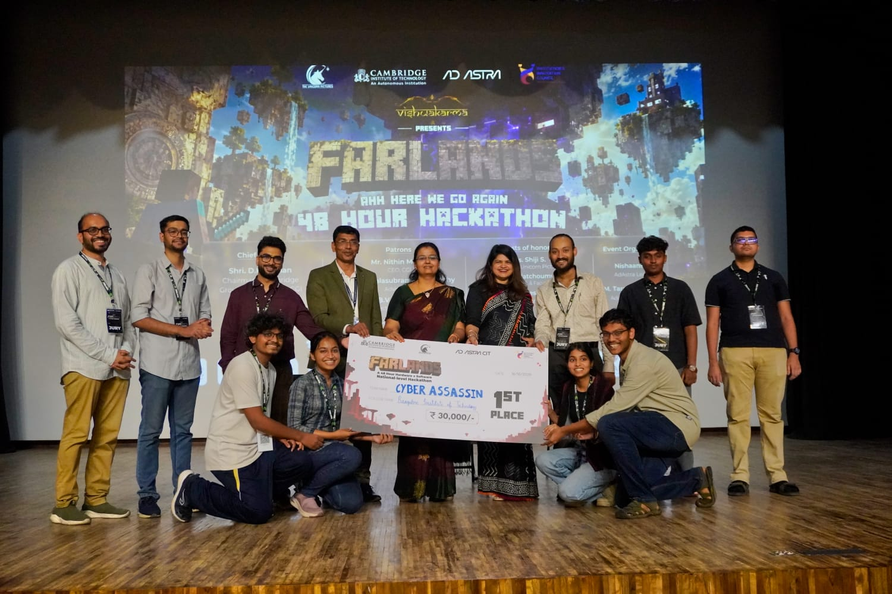
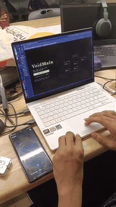

<p align="center">
  
</p>

<p align="center">
  
  
  
  
  
  
  
  
</p>

---

## Demo

<p align="center">
  <a href="media/demo.mp4" title="Play the VoidMain demo">
    
  </a>
  <br/>
  <b>▶︎ <a href="https://github.com/ADITYA02NM/voidmain/releases/download/v0.5.0/demo.mp4">Play the full demo (88 s)</a></b>
  &nbsp;·&nbsp; GREEN → YELLOW → RED → PURPLE → recovery
</p>

<!-- GitHub's README renderer strips <video> tags in repo context (no host is
     allow-listed), so the inline player below is an animated GIF derived from
     media/demo.mp4 — 8x speed, ~11 s, 89 frames. Click it for the full clip. -->
<p align="center">
  <a href="media/demo.mp4" title="Play the full 88 s demo">
    
  </a>
</p>

| Asset | Link |
|---|---|
| 🎬 Demo video (88 s, MP4) | [play](https://github.com/ADITYA02NM/voidmain/releases/download/v0.5.0/demo.mp4) · [in repo](media/demo.mp4) |
| 🎞️ Inline preview (11 s GIF) | [media/demo.gif](media/demo.gif) |
| 🖼️ Result screenshot | [media/win.jpeg](media/win.jpeg) |
| 📑 Slide deck (7 pages) | [docs/DECK.pdf](docs/DECK.pdf) |
| 📦 Release notes | [v0.5.0](https://github.com/ADITYA02NM/voidmain/releases/tag/v0.5.0) |

---

# VoidMain

> **Many sensors. One brain. Coordinated responses.**
> **VoidMain** is an adaptive, security-aware IoT coordination system that runs
> **many sensors → one deterministic decision → many coordinated outputs**, with
> every decision explainable, logged, and acknowledged.

Where traditional automation fires **one sensor → one action**, VoidMain runs
**many sensors → one deterministic decision → many coordinated outputs** across
the full IoT layer — doors, cameras, environmental controls, and perimeter
sensors — with every action traceable back to its cause.

---

## Product overview

VoidMain is a local-only IoT coordination platform for smart-home and small-site
monitoring. It fuses events from many sensors into a single 0–100 risk score,
maps that score to a colour band (GREEN → YELLOW → RED → PURPLE), and drives
coordinated automation across the device fleet when the band escalates.

**What it monitors:**

| Device | Kind | Room | States |
|---|---|---|---|
| Campfire | extinguish | Backyard | Burning / Waning / Smoldering / Extinguished |
| Air Purifier | purifier | Living Room | On auto / Filter low / Off / Boosted |
| Front Door | lock | Entrance | Locked / Ajar / Opened unexpectedly / Auto-locked |
| Front Camera | camera | Entrance | Armed recording / Motion clip / Person detected / High-res |
| Yard Motion | motion | Yard | Clear / Motion after hours / Person detected / Cleared |

**Deployment topology (3 laptops + ESP32 panel + alert phone):**

- **Laptop 1** — runs the MQTT broker, the backend server, and the bus director
  (scenario publisher). Opens doors, triggers devices, drives the scene.
- **Laptop 2** — operator dashboard at `http://<ip>:8080`, signed in with the
  LAN access code. The main operational view.
- **Laptop 3** — debug inspector + trigger console at `http://<ip>:8080/debug.html`.
  Triggers every element: devices, alerts, score, band, health, IDS events, and
  the ESP32 LED through green / yellow / red / purple.
- **ESP32-C3** — wall-mounted OLED + NeoPixel LED, subscribed to the risk,
  health, alert, device, and LED topics. Mirrors the same MQTT stream.
- **Alert phone** — `http://<ip>:8080/alerts`, a phone-friendly standalone alert
  feed signed in with the LAN access code.

**The loop:** many sensors → one deterministic decision → many coordinated outputs.
Every decision is explainable, logged, and acknowledged.

---

## What VoidMain delivers

| Criterion | How VoidMain delivers |
|---|---|
| **Target users** | Operators of smart-home and small-site IoT deployments who need coordinated, auditable responses to multi-sensor events |
| **End-to-end functionality** | Sensors → MQTT → risk engine → band → dashboard + ESP32 + alert phone, with ACK round-trip |
| **Reliability** | Self-reconnecting MQTT bridge, 24-hour evidence history, session-gated WS, stale/offline detection on every screen |
| **False alarms & missed events** | Hysteresis on band transitions, per-device severity, multi-sensor fusion before PURPLE automation |
| **Smart automation** | PURPLE band triggers coordinated actions across door locks, cameras, air purifier, and campfire — one decision, many actuators |
| **Measurable performance** | Bus→screen latency histogram (p50/p95/p99) on the debug console, 30-day score history, event counters |
| **Real-world value** | One dashboard for all IoT devices, one alert feed for the phone, one LED strip for the wall — all from one broker |
| **Failure handling** | Node heartbeat aging (yellow at 15 s, red at 30 s), degraded banner when MQTT drops, reconnection backoff |
| **User experience** | Colour-banded UI, toast notifications, ACK buttons, command console, device detail panel, history chart |
| **Product scalability** | Hardware-optional architecture: the decision engine never knows whether an event came from an ESP32 or the bus director — both translate into the same normalized schema |

---

## Architecture

```
Sensors / events  →  MQTT broker (Mosquitto, localhost)  →  Backend (aiohttp)
                                                                   ↓
                                         WebSocket  →  Dashboard (React)
                                         voidmain/sim/*  →  Bus director → MQTT
                                         voidmain/alert/*  →  Alert phone
                                         voidmain/risk/*  →  ESP32 OLED + LED
```

**Topics (allowlisted subscribe set):**

- `voidmain/health/#` — node heartbeats (pi4, pi3a, pi3b, esp32)
- `voidmain/alert/#` — alerts, owned by Pi3b
- `voidmain/risk/score` + `voidmain/risk/band` — risk engine output
- `voidmain/lan/#` — LAN device detection
- `voidmain/tripwire/#` — segment tripwires
- `voidmain/suricata/#` + `voidmain/wifi/#` — IDS / WiFi events
- `voidmain/device/#` — IoT device state
- `voidmain/sim/*` — debug console + dashboard trigger relay (server never writes risk/#)

**Evidence log:** SQLite, 24-hour rolling window of scores + alerts with ACK state,
replayed to any browser that joins mid-session.

---

## Quickstart (single laptop, no hardware)

**Prerequisites:** `mosquitto`, Python ≥ 3.11, Node ≥ 18.

```bash
# 1 — local MQTT broker (localhost:1883 only)
mosquitto -d

# 2 — backend
cd dashboard
python3 -m venv venv
venv/bin/pip install -r server/requirements.txt
VOIDMAIN_HTTP_PORT=8080 VOIDMAIN_DEMO_CODE=demo venv/bin/python -c "from server.main import main; main()"

# 3 — sign in with the LAN access code (VOIDMAIN_DEMO_CODE), or register a
#     WebAuthn passkey on first run
venv/bin/python -m server.auth_cli enroll-token   # optional passkey enrollment

# 4 — frontend
cd dashboard/web
npm install
npm run dev          # → http://localhost:5173 (proxies /ws /auth /healthz to :8080)

# 5 — scenario publisher (full GREEN→YELLOW→RED→PURPLE→decay replay)
venv/bin/pip install paho-mqtt
venv/bin/python tools/mock_feed.py --host 127.0.0.1 --port 1883
#    tours once at boot, then idles at GREEN — press ▶ SIM TOUR in the
#    dashboard to replay (add --no-auto to boot straight into idle)
```

**3-laptop rig:** set `VOIDMAIN_ALLOW_LAN=1`, `VOIDMAIN_ORIGINS` to the LAN
origin, and `VOIDMAIN_DEMO_CODE` to a shared code. `start.sh` prints the banner
with all the values the other laptops need.

**Alert phone:** open `http://<ip>:8080/alerts` on the phone and sign in with
the LAN access code. The page polls `/alerts.json` every 3 seconds.

---

## Debug console (laptop 3)

`http://<ip>:8080/debug.html` — session-gated WS inspector with a trigger console.
Every button publishes `voidmain/sim/<id>`; the bus director executes it on the
real MQTT stream, so the dashboard, the debug console, and the ESP32 OLED all
move together.

**One-press presets:**

| Preset | What it does |
|---|---|
| GREEN · warm baseline | Score 10, all 5 devices GREEN, nodes up |
| GREEN · quiet idle | Score 3, heartbeat only |
| YELLOW · motion | Yard motion after hours, score 45 |
| RED · intrusion | Front door + camera person detection + campfire smoldering, score 70 |
| PURPLE · automation | Door locked, camera high-res, air purifier boosted, campfire extinguished, score 90 |
| FULL TOUR | GREEN → YELLOW → RED → PURPLE → GREEN |
| ACK last alert | Acknowledges the newest open alert on every screen |
| Failure · pi3a down | Stops pi3a heartbeats; tile ages yellow at 15 s, red at 30 s |
| Failure · pi3a up | Restores pi3a heartbeat |
| Edge · IDS + rogue AP | Unknown LAN device, rogue AP, Suricata signature |
| ESP32 LED cycle | Drives the ESP32 NeoPixel through green / yellow / red / purple |

**Per-device buttons:** each of the 5 devices has green / yellow / red / purple
state buttons. **Score buttons:** 0, 10, 25, 45, 65, 75, 90, 100. **Band buttons:**
GREEN / YELLOW / RED / PURPLE presets.

The colour strip at the top mirrors the live bus band + most recent alert/device
severity. When the backend is reachable over the LAN it labels itself `FPGA+TINSIM`
and also publishes `voidmain/sim/esp32-led` so the ESP32 panel drives its LED.

---

## Evidence data (pre-populated)

The evidence database ships with 30 days of score history (14,000+ points) and
2,800+ alerts across all severities (info, yellow, red, purple, green), plus
device state events and edge/IDS events. Regenerate with:

```bash
venv/bin/python tools/gen_data.py --days 30
```

---

## Reliability & failure handling

- **MQTT bridge:** self-reconnecting with exponential backoff (1 s → 5 s cap).
  Toast "MQTT LIVE" / "MQTT DEGRADED" on every connected browser.
- **Node health:** each node publishes heartbeats; tiles age yellow at 15 s,
  red at 30 s of silence.
- **Session gating:** every WebSocket upgrade and every debug trigger requires a
  valid session. Logout/revocation closes all sockets for that session within 1 s.
- **Rate limiting:** 5 attempts per 5 minutes per IP on auth endpoints.
- **Origin check:** WebSocket upgrade requires a matching Origin header.
- **Evidence durability:** SQLite WAL mode, one short transaction per event.

---

## Repository layout

```
voidmain/
├── dashboard/
│   ├── web/                # React + TS operator console (Vite)
│   ├── server/             # aiohttp backend: MQTT bridge, auth, SQLite, WS, RAG
│   │   ├── main.py         # entry point
│   │   ├── bridge.py       # MQTT ↔ WebSocket hub
│   │   ├── config.py       # VOIDMAIN_* env config
│   │   ├── triggers.py     # device catalogue + trigger allowlist
│   │   ├── evidence.py     # SQLite evidence writer
│   │   ├── db.py           # read-only evidence reader
│   │   ├── rag.py          # local console assistant (BM25 + Ollama)
│   │   ├── auth.py         # session / passkey / access-code routes
│   │   └── auth_cli.py     # passkey enrollment / audit / token
│   ├── tools/
│   │   ├── mock_feed.py    # scenario publisher (GREEN→PURPLE replay)
│   │   └── gen_data.py     # evidence DB generator
│   ├── alerts.html         # phone-friendly alert feed
│   ├── debug.html          # WS debug inspector + trigger console
│   └── tests/
├── firmware/
│   └── esp32-risk-mini/    # ESP32-C3 firmware (OLED + NeoPixel risk mirror)
├── docs/                   # product brief, run-of-show, slide deck
├── media/                  # demo video + result screenshot
├── assets/                 # banner + architecture SVGs
├── .github/                # CI workflow + issue / PR templates
├── start.sh                # one-command local stack launcher
├── LICENSE                 # MIT
├── CHANGELOG.md
├── CONTRIBUTING.md
└── README.md
```

---

## Status

| Component | State |
|---|---|
| Dashboard (web + server) | Operator console, MQTT bridge, session/passkey/access-code auth, SQLite evidence, WS feed |
| 5-device IoT fleet | Campfire, Air Purifier, Front Door, Front Camera, Yard Motion |
| ESP32-C3 panel | OLED + NeoPixel LED, subscribed to risk/health/alert/device/LED topics |
| Alert phone | Standalone phone-friendly alert feed at /alerts |
| Debug console | Session-gated WS inspector + trigger console at /debug.html |
| Evidence history | 30 days pre-populated, 24-hour rolling window |
| Scenario publisher | Full GREEN→YELLOW→RED→PURPLE→decay replay, triggered from dashboard or debug console |
| AI assistant | Local RAG (BM25 over repo docs) + Ollama, zero cloud, session-gated |

**North star:** one complete, observable, repeatable control loop —
reliability over feature count.

---

## Credits

- **Event:** Farlands · Innovation Mission 7 — *Connected Infrastructure:
  Adaptive Intelligent IoT Systems*.
