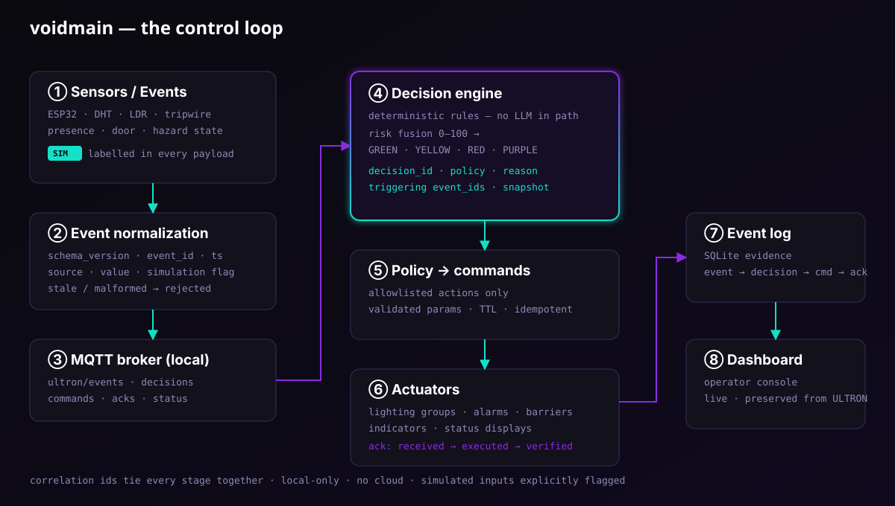

<p align="center">
  
</p>

<p align="center">
  <a href="https://farlands-registration.vercel.app/farlands-problem-statements.pdf"></a>
  
  
  
  
  
  
  
</p>

---

# voidmain

> **Many sensors. One brain. Coordinated responses.**
> **voidmain** is an adaptive, security-aware IoT coordination system — the IoT
> evolution of the [ULTRON](https://github.com/ADITYA02NM/ULTRON) smart-house
> security platform — built for **Farlands Innovation Mission 7: Connected
> Infrastructure — Adaptive Intelligent IoT Systems**.

Where traditional automation fires **one sensor → one action**, voidmain runs
**many sensors → one deterministic decision → many coordinated outputs**, with
every decision explainable, logged, and acknowledged.

---

## The problem (verbatim, Mission 7)

> *"Traditional automation systems often react to individual sensor readings
> without understanding the overall condition of the environment."*

Threshold automation is blind to context: the light turns on in an empty room,
the alarm stays silent because "temperature is still normal", and a dead sensor
silently feeds weeks-old data. voidmain fixes the *architecture*, not the
threshold.

## What counts as a win (Mission 7 alignment)

| Mission 7 criterion | How voidmain delivers |
|---|---|
| **Stage 1 — Foundation** ✅ | Multiple sensors + connected devices collecting and communicating real-time data over local MQTT |
| **Stage 2 — Functional** | Multi-sensor fusion drives **multiple actuators** through one policy decision — not independent threshold rules |
| **Stage 3 — Innovation** | Anomaly detection / prediction on the event history via the inherited VoidMain risk engine |
| **Minimum deliverable** | Multiple sensors influencing **coordinated responses across multiple connected components** |
| **Constraints** | Physical IoT hardware *or* simulated sensor data — ours are **explicitly labelled `simulated`** in every payload |
| **Suggested tech** | ESP32 · Raspberry Pi · DHT/LDR · MQTT · Python — all in the design, adapters keep hardware optional |

---

## The loop

```mermaid
flowchart LR
    S["Sensors / Events<br/>(real or SIMULATED)"] --> N["Event normalization<br/>versioned schema"]
    N -->|"voidmain/events"| B[("Mosquitto<br/>localhost")]
    B --> D["Decision engine<br/>deterministic rules"]
    D -->|"voidmain/decisions"| P["Policy evaluation<br/>allowlist + timeouts"]
    P -->|"voidmain/commands"| A["Actuators<br/>lights · alarms · barriers"]
    A -->|"voidmain/acks"| L[("SQLite<br/>evidence log")]
    L --> H["Operator dashboard<br/>preserved from VoidMain"]
```

<p align="center">
  
</p>



**Everything is correlated.** One `trace_id` ties sensor event → decision →
command → acknowledgement → log row, so a judge can follow any action back to
its exact cause.

---

## Design principles

- **🎯 Deterministic decisions.** Rules and thresholds — never an LLM in the
  control path. An optional AI may *explain* events; it can never issue
  commands.
- **🏷️ Honest simulation.** Simulated readings carry `simulated: true` and a
  `SIM` label in UI and logs. A campfire is a visual, not a thermometer.
- **🔒 Local-only.** Broker binds to localhost. No cloud, no port forwarding,
  no exposed RCON, no public MQTT.
- **🧩 Hardware-optional.** The decision engine never knows whether an event
  came from an ESP32 or a simulator — adapters translate both into the same
  normalized schema.
- **📜 Explainable.** Every decision records policy ID, reason, triggering
  event IDs, and a state snapshot.
- **🛡️ Fail-safe.** Stale or malformed events are rejected or marked UNKNOWN —
  old data is never silently treated as current.

---

## Repository layout

```
voidmain/
├── assets/                 # banner + architecture SVGs
├── ppt.md                  # 7-slide pitch deck design prompt (Farlands IM7)
├── dashboard/
│   ├── web/                # React + TS operator console (Vite, hand-built SVG/canvas)
│   ├── server/             # aiohttp backend: MQTT bridge, WebAuthn auth, SQLite, WS feed
│   │   ├── main.py         # entry point (HTTP :8080 / :8081 dev)
│   │   ├── bridge.py       # MQTT ↔ WebSocket hub
│   │   ├── config.py       # VOIDMAIN_* env config
│   │   └── auth_cli.py     # passkey enrollment / audit
│   ├── tools/mock_feed.py  # DEV-ONLY scenario publisher (full GREEN→PURPLE replay)
│   ├── tests/              # pytest suite
│   └── pytest.ini
└── README.md
```

---

## Quickstart (laptop, zero hardware)

**Prerequisites:** `mosquitto`, Python ≥ 3.11, Node ≥ 18.

```bash
# 1 — local MQTT broker (localhost:1883 only)
mosquitto -d

# 2 — backend (dev port 8081 matches the Vite proxy)
cd dashboard
python3 -m venv venv
venv/bin/pip install -r server/requirements.txt
VOIDMAIN_HTTP_PORT=8081 venv/bin/python -c "from server.main import main; main()"

# 3 — first-run passkey owner (fresh auth.db)
venv/bin/python -m server.auth_cli enroll-token

# 4 — frontend (Vite, :5173 → proxies /ws /auth /healthz → :8081)
cd web
npm install
npm run dev          # → http://localhost:5173

# 5 — end-to-end demo feed (DEV-ONLY: replays GREEN → YELLOW → RED → PURPLE → decay)
venv/bin/pip install paho-mqtt
venv/bin/python tools/mock_feed.py --host 127.0.0.1 --port 1883
```

**Tests:**

```bash
cd dashboard
venv/bin/pip install pytest pytest-asyncio
venv/bin/pytest
```

**Shutdown:** Ctrl-C the backend and Vite; `mosquitto` keeps running as a daemon
(`sudo killall mosquitto` when done).

---

## Status & honesty statement

| Component | State |
|---|---|
| Dashboard (web + server) | **Inherited verbatim from VoidMain** — untouched frontend, preserved contracts |
| MQTT backbone, event/decision log | Implemented in VoidMain; reused here |
| Decision engine | VoidMain risk fusion (0–100 → GREEN/YELLOW/RED/PURPLE) + voidmain coordination policies |
| Physical ESP32/Pi sensors | **Not part of this repo's demo** — hardware track runs in parallel; adapters will connect them later |
| Simulated sensors | Clearly labelled `simulated: true` everywhere |
| Minecraft bridge | Planned, not implemented (see roadmap) |

Nothing here is claimed as physically validated hardware. What you can run
today is the full **software loop on one laptop**.

---

## Roadmap

- [x] **Stage 1 — Foundation:** normalized multi-source events, MQTT backbone,
      dashboard, event/decision log, deterministic engine running locally
- [ ] **Stage 2 — Functional:** multi-input → multi-output coordination demo,
      acknowledgements, stale-sensor handling, end-to-end test harness
- [ ] **Stage 3 — Innovation:** anomaly detection & pattern analysis over the
      event history (optional)

**North star:** one complete, observable, repeatable control loop —
*reliability over feature count.*

---

## Credits

- **Lineage:** [ADITYA02NM/ULTRON](https://github.com/ADITYA02NM/ULTRON) —
  the zero-cloud IoT security ecosystem this project evolves from.
- **Event:** Farlands · Innovation Mission 7 — *Connected Infrastructure:
  Adaptive Intelligent IoT Systems*.
- Dashboard, risk engine, and evidence store are reused under the principle
  **"don't rebuild what already works."**
